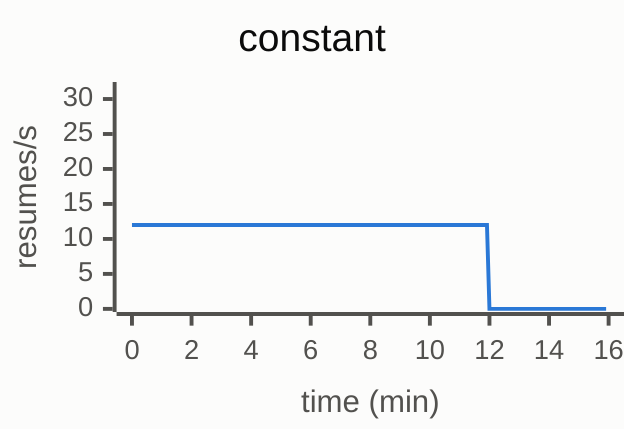
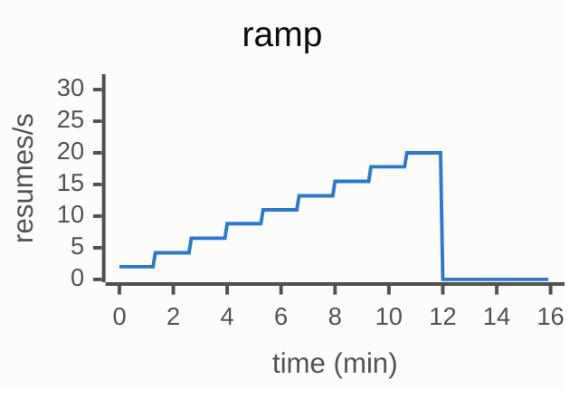
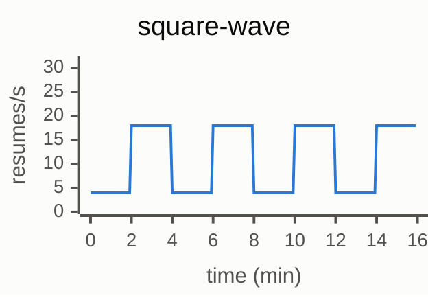
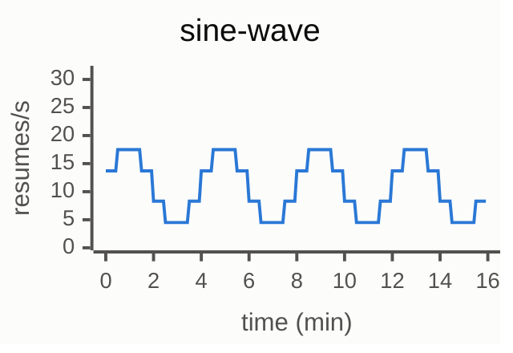
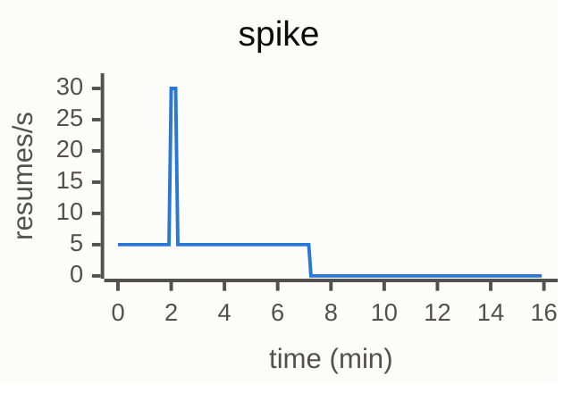
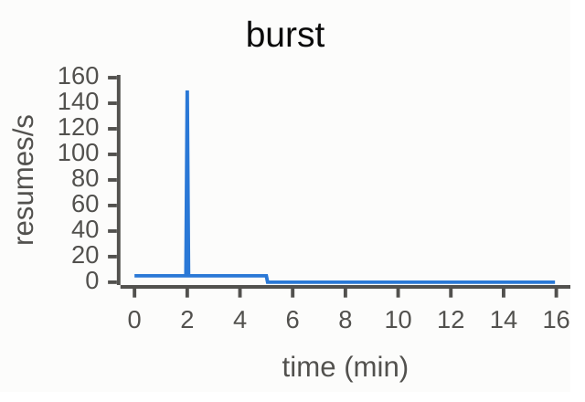
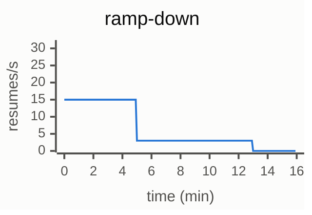

# GKE test plan: actor scheduling policies

You are picking this up from another session that had no GKE access. You have no access to that session's files. Everything you need is in this document and in the GitHub branch named in section 2. Read it all before you start.

## 1. What we are deciding

`ate-api-server` picks a worker for every actor resume. Today it uses power of two choices (`p2c`): sample two workers, take the less loaded one. That spreads actors over the whole fleet, so after load drops almost no worker is empty and nothing can be scaled down without killing running actors.

We want a policy that meets two goals:

1. Low bind latency. A bind fails and retries when the picked worker filled up between the cached read and the database check. Fewer retries is better.
2. After load drops, many workers are completely empty, so the pool can scale down without touching a running actor.

A simulator and a laptop kind cluster say a new policy, `prefixsat`, does both. Neither can answer the questions below. That is your job.

- **Q1.** Do the retry and empty-worker numbers hold on real `ate-api-server` and Postgres at 1000 workers?
- **Q2.** Does packing hurt real gVisor restores? It concentrates restores on a few workers and fills nodes, and actors with a node-local snapshot must resume on their node.

Q2 is the gate. If packing crashes actors or makes resumes much slower on a real data plane, the policy is not adoptable as it stands.

## 2. Where the code is

The experiment code is one commit on a fork:

- Repository: `https://github.com/laoj2/substrate`
- Branch: `scheduler`
- Commit: `ef59cb7a7` ("scheduler experiments"), on top of upstream `main` at `94e0a26ac`
- Diff against upstream: `https://github.com/agent-substrate/substrate/compare/main...laoj2:substrate:scheduler`

```bash
git clone --branch scheduler https://github.com/laoj2/substrate.git
cd substrate
git log --oneline -1   # expect ef59cb7a7
```

Do not push to either repository and do not open a PR. Local changes to the driver are fine. Send them back as a patch (`git diff`) with your results.

| File | What it holds |
|---|---|
| `cmd/ateapi/internal/scheduling/scheduling.go` | `Policy`, `PolicyFromEnv`, every policy. `schedulePrefix` is the new one. |
| `cmd/ateapi/internal/controlapi/workflow.go` | Passes `PolicyFromEnv()` to the scheduler. |
| `cmd/ateapi/internal/controlapi/workflow_resume.go` | Logs `schedexp assignment retry` on every bind retry. Also the cache fix: a failed bind puts the row it read into the worker cache (`workerCache.Observe`). |
| `cmd/ateapi/internal/scheduling/schedsim/main.go` | The simulator, and the scenario and pattern definitions the live driver shares. |
| `cmd/ateapi/internal/scheduling/schedsim/kind.go` | The live driver (`schedsim -kind`). Despite the name it works on any cluster. |
| `cmd/ateapi/internal/scheduling/schedsim/kind-*.sh` | Earlier scripts for a local kind cluster. Use them as a reference only. They have the two measurement traps in section 8. Use the scripts in the appendix. |

`ate-setup` builds images from the checkout with ko. Install from this clone so the `ate-api-server` image has the policies. All experiment code is marked `EXPERIMENT ONLY` and is not meant for upstream.

## 3. Policies to test

The policy is set with one environment variable on the `ate-api-server` container: `ATE_API_SCHEDULING_POLICY=name[:K[:watermark]]`. Unset means `p2c`.

| Policy | Env value | What it does | Role in the test |
|---|---|---|---|
| p2c | `p2c` | Less loaded of 2 random workers. | Baseline. Current behavior. |
| bestofd-3 | `bestofd:3` | Fullest of 3 random workers. | The earlier candidate. |
| prefixsat | `prefixsat:1:0.2` | See below. | The new candidate. |
| prefixsat, more headroom | `prefixsat:1:0.3` | Same, 30% headroom. | Run if 20% shows hot workers in Q2. |
| bin-packing | `mostallocated` | Fullest worker with room. | Optional, small scale only. It collapses at 1000 workers in the simulator. |

"Fullest" and "load" mean the highest of slot, CPU and memory utilization.

### How prefixsat picks

1. Sort the eligible workers oldest first (`create_time`, then pod name). Every replica computes the same order.
2. Walk the order, summing each worker's load into `used` and its free share into `free`. Both count in workers, so 1.0 is one worker's worth.
3. Stop at the shortest prefix where `free >= max(K, watermark * used)` and at least two workers have room. With `prefixsat:1:0.2`, K is 1 worker and the headroom is 20%.
4. Pick two random workers with room in that prefix and take the less loaded one.
5. If no prefix has that much free capacity (the fleet is nearly full), take the fuller of the two instead. That leaves room for large actors.

Workers past the prefix get no new actors, so they empty as their actors suspend.

After changing the variable, confirm each new pod logged the policy:

```
{"level":"INFO","msg":"scheduling policy","name":"prefixsat","k":1,"watermark":0.2}
```

Two things the real code does not have, so do not expect them:

- The simulator's "NoWait" (retry at once after a failed bind). Real retries sleep `assignmentBackoff`, 15ms and up.
- The simulator's long-lived hint (`Constraints.LongLived`). Nothing in `ate-api-server` sets it.

## 4. What we know so far

Use these as predictions. A large gap from them is a finding.

**Simulator, 1000 workers of 16 slots, ramp-down pattern**

| Policy | Retries per resume, fast timing | Same, GKE-like timing | Empty workers 8 min after the drop | Time to place p99, fast timing |
|---|---|---|---|---|
| p2c | 0.000 | 0.000 | 10 | 4ms |
| bestofd-3 | 0.013 | 0.058 | 309 | 8ms |
| prefixsat | 0.003 | 0.011 | 565 | 4ms |
| bin-packing | 2.1 | not run | 609 | 2,076ms |

GKE-like timing is a 12ms bind, a 200ms outbox poll and 3 replicas. The simulator's latencies are model inputs, so compare retries and empties, not milliseconds.

**Simulator, node pinning (1000 workers, 10 per node, 30 minute detach delay)**

| Policy | Detaches per 148,000 resumes | Empty workers +8 min | Empty nodes +8 min |
|---|---|---|---|
| p2c | 22 | 7 | 0 of 100 |
| bestofd-3 | 825 | 331 | 0 |
| prefixsat | 4,266 | 489 | 0 |

A detach means the actor's node was full, so it dropped its local snapshot and resumed elsewhere from object storage.

**Simulator, restore concentration:** prefixsat puts up to 16 placements on one worker in one second. p2c puts 5.

**Laptop kind, fake data plane, 200 workers of 16 slots, real `ate-api-server` and Postgres, prefixsat**

| Measure | Smoke (1 min, 25 resumes/s) | ramp-down (peak 75 resumes/s) | Simulator, ramp-down |
|---|---|---|---|
| Resumes placed | 1,472 of 1,472 | 29,871 of 29,871 | all |
| Errors, no-capacity | 0 | 0 | 0 |
| Bind retries | 1 | 77 (0.0026 per resume) | 0.003 per resume |
| Time to place p50, p99 | 12ms, 35ms | 16ms, 77ms | model input |
| Empty workers 1, 3, 8 min after the drop | not applicable | 5, 9, 111 | 7, 12, 109 |

The same ramp-down cell counted 1 retry when the logs were read after the run and 77 when streamed, which is the log rotation trap in section 8. There is no valid kind result for p2c or bestofd-3 yet. The first attempt was lost when Postgres was restarted mid-run (also in section 8).

**Simulator prediction for that 200-worker setup,** which Phase A step 1 repeats:

| Policy | Retries per resume | Empty +8 min (of 200) |
|---|---|---|
| p2c | 0.000 | 1 |
| bestofd-3 | 0.018 | 63 |
| prefixsat | 0.003 | 109 |

## 5. The driver

Build it from the clone:

```bash
go build -o /tmp/schedsim ./cmd/ateapi/internal/scheduling/schedsim
```

It has two modes:

- `-kind -setup -scenario S -atespace A` creates the actor population for scenario `S` in atespace `A`.
- `-kind -scenario S -pattern P -policy LABEL -atespace A -seed 1 -out DIR` runs one cell. `-policy` is only a label for the output. You set the real policy on the Deployment.

It port-forwards to every ready `ate-api-server` pod, resumes actors at the pattern's rate, holds each one 20 to 40 seconds, and suspends it. In `ramp-down`, 3% of actors hold 5 to 10 minutes. It polls `ListWorkers` every 5 seconds for the fleet numbers.

Scenarios and patterns are in `scenarios()` and `patterns()` in `schedsim/main.go`. A scenario fixes the pool shape, the actor sizes, the population and a rate multiplier. The actor templates it expects are named `sched-<cpu>m` (for example `sched-250m`) in atespace `benchmark-workloads`.

To size a new scenario for a fleet that holds `C` actors in total:

- `rateScale = C / 640`. That makes the ramp-down peak about 89% of capacity.
- `population = 1.25 * C`.

The patterns to use:

| Pattern | Shape | Length | Use |
|---|---|---|---|
| `ramp-down` | 5 min high, 8 min at a fifth of it, 3 min of nothing | about 24 min with the tail | Empty workers after the drop |
| `burst` | steady low rate, 3 seconds at 30 times that, steady again | about 6 min | Retries under a spike |
| `smoke` | 1 min at a low rate | about 2 min | Checking the setup |

The appendix has two scripts. `setup.sh` creates a pool, a template and the population. `run-cell.sh` runs one cell: it sets the policy, waits for the rollout, streams the retry log lines, runs the driver, and writes `retries.csv`. Save them into the clone and run them from its root. Both act on whatever cluster the current kubectl context points at, so check the context first.

## 6. Phase A: fake data plane, 1000 workers (answers Q1)

This measures `ate-api-server` and Postgres only. Actors do not exist, so it says nothing about restores.

**Setup**

- Install with the fake data plane as `docs/guides/benchmarking.md` ("Isolate Mode") and `benchmarking/automation/ateapi-cold-resume.md` in the repository describe: `go run ./cmd/ate-setup deploy ate-system --fake-data-plane`, with `--cordon-system-infra-components` and the two node pools that needs. Never do this on a cluster that serves real actors.
- Run at least 2 `ate-api-server` replicas, 3 if you can. Staleness between replicas is what causes retries, so the automation's single replica would hide the effect. Give each a fixed CPU request and limit (the automation uses 2 CPU, 4Gi).
- Keep `replicas * (pool max conns + 5)` under Postgres's `max_connections` (100 by default). Set the pool with `--ateapi-postgres-pool-max-conns`.
- Do not set a fake-atelet delay. It would bury the bind time inside the resume latency.
- Create the pool with the `ate.dev/fake-max-actors: "16"` annotation and limits of 4 CPU and 8Gi, as `setup.sh` does when you pass it a sixth argument. The template is `sched-250m` (250m CPU, 512Mi).

**Steps**

1. Scenario `f-kind200` (200 workers, peak 75 resumes per second). This repeats the laptop run, so it checks your setup against known numbers.
2. Scenario `d-large` (1000 workers, 20,000 actors, peak 375 resumes per second). Set the pool to 1000 replicas.

For each step, run `ramp-down` and `burst` for `p2c`, `bestofd:3` and `prefixsat:1:0.2`.

**Run every cell at least twice,** with seeds 1 and 2 (the last argument of `run-cell.sh`). Do one full pass over all cells, then the second pass, shuffling the policy order in each. That way slow drift on the cluster does not favor one policy. If the two runs of a cell disagree by more than about 30% on retries or empty workers, run it a third time.

**Record per cell**

- `resumes`, `placed`, `no_capacity`, `failed`, `other_errors` from `runs.csv`.
- `ttp_p50_ms`, `ttp_p95_ms`, `ttp_p99_ms`: time to place, from the first `ResumeActor` call to its return, retries included.
- Bind latency p50 and p99 from the metric `ate.scheduler.assignment.duration` (one attempt to assign a worker) over the cell's time window. This needs Prometheus. Without it, write `not measured`.
- `filled_up` retries, and retries per resume.
- `empty_drop_60`, `empty_drop_180`, `empty_drop_480`: workers with no running actor 1, 3 and 8 minutes after the drop. The 8 minute count is the headline number for goal 2. Nothing is scaled down in this plan.

**Proposed pass rule for prefixsat (the user decides):** every resume placed, retries per resume no higher than bestofd-3's, and at least 1.5 times bestofd-3's empty workers at +8 min.

**Known risk:** the driver reaches `ate-api-server` through port-forwards, and the benchmarking guide says those reset under load. They held at 75 resumes per second on a laptop. If `other_errors` is not zero at 375 per second, that is probably the cause **[I need to verify this claim]**. The driver has no flag to dial a Service address yet. Adding one in `connect()` in `kind.go` is the fix.

## 7. Phase B: real data plane, several nodes (answers Q2, the gate)

**Setup**

- A normal install: real atelet, gVisor workers.
- At least 8 nodes, and at least 3 worker pods per node. Fewer than that and node effects do not show.
- Size the worker and the actor so 8 to 16 actors fill a worker by CPU. For example workers of 2 CPU and 4Gi with the `sched-250m` template hold 8.
- Real workers report 1000 actor slots whatever their size, so add a scenario for your pool to `scenarios()` with `slots: 1000` and the pool's real CPU and memory. Use the sizing rule in section 5. The scenario's pool name must match the WorkerPool's name.
- Keep atelet's defaults (`--snapshot-detach-delay` 30m, `--snapshot-upload-delay` 5m). They are what pins a suspended actor to its node.
- Install Prometheus as the benchmarking guide describes, so the server-side metrics below exist.

**Use a fresh actor population for every cell.** A suspended actor stays pinned to the node it last ran on for 30 minutes. If cells share actors, each cell starts with the previous policy's placement. Give each cell its own atespace (`-atespace cell-<n>`) and run `-setup` for it first.

**Cells:** `ramp-down` and `burst` for `p2c`, `bestofd:3` and `prefixsat:1:0.2`. If prefixsat shows hot workers, add `prefixsat:1:0.3`. As in Phase A, run every cell at least twice with seeds 1 and 2, in two shuffled passes, each run on its own fresh population.

**Record per cell,** on top of everything in Phase A:

| What | Where | Why |
|---|---|---|
| `ttp_p50/p95/p99_ms` | `runs.csv` | `ResumeActor` now includes the real restore, so this is the user-visible cost of a hot worker. |
| Actor crashes | metric `ate.actor.crashes` | A restore wave onto a busy node can time out the wakeup probe and crash the actor. |
| Restore time p50 and p99 | metric `ate.actor.restore.duration` | Shows restores slowing down under concentration. |
| Detaches | count the `ate-api-server` log line `Detached actor from its full node to resume it on another node` | The cost of node locality under packing. |
| Detach latency | `ttp` of the resumes that detached, if you can join them, else the p99 shift | The simulator guesses 50ms. The real number is unknown. |
| CPU pressure | `node_psi` and `pod_psi` from the benchmark runner, or the kernel PSI metrics | Early sign of a saturated node. |
| Actors per node over time | `ListWorkers` gives each worker's node and allocation | Shows whether load piles onto a few nodes. |

The driver does not record the last one yet. Either extend `sample` in `kind.go` to write a per-node count, or poll the workers with `kubectl ate` every 10 seconds into a file.

**Proposed gate (the user decides):** no more actor crashes than p2c, and `ResumeActor` p99 within 1.5 times p2c's. Report detaches for every policy either way.

**Limit of this phase:** the driver's actors sit idle, so a hot worker only hurts through restore bursts, not through actors competing for CPU. If the gate passes, repeat the comparison with the agent-session benchmark from the benchmarking guide, which burns CPU in every actor, setting the same environment variable. Compare `WakeFirstTouch`, `TimeToWake` and crashes.

## 8. Measurement traps

- **Count retries from a live stream, not after the run.** `ate-api-server` logs every RPC and its log rotates at 10 MiB. Reading with `kubectl logs` after a 16 minute run loses most of it. `run-cell.sh` streams during the run. On GKE, Cloud Logging should also work **[I need to verify this claim]**.
- **Wait for old pods to go after a policy change.** `kubectl rollout status` returns while the old pods are still shutting down. Until they are gone, the driver can dial a pod that runs the previous policy. `run-cell.sh` waits until the pod count equals the replica count.
- **Relax the Postgres probes before any load.** The bundled Postgres has liveness and readiness probes with a 1 second timeout and 3 failures. Under load on kind the liveness probe restarted Postgres in the middle of a cell. Set `timeoutSeconds: 5` and `failureThreshold: 6` on both, as the benchmarking guide's "Running at scale" section says, and give Postgres a CPU request sized for the run.
- **A cell is valid only if `other_errors` is 0** and Postgres and `ate-api-server` did not restart during it. Check restart counts after every cell.
- **After a failed cell, start clean.** Actors can be left stuck in a transitional state, and the driver's reset then gives up ("N actors still not suspended"). Delete and recreate the WorkerPool, and use a new atespace with a fresh population.
- **Latency is noisy, so always report it with its spread.** On kind, p99 was 26 to 45ms for every policy. Latency is still a required result. Report it for every cell from at least two runs, and read a small latency difference together with the retry count, which is steadier.
- **Keep the load generator off the nodes under test** and keep the machine awake for the whole cell.
- **One cell at a time.** Do not run anything else heavy on the cluster or the driver's machine during a cell.
- **Trim nothing by hand.** The driver measures from fixed offsets after the drop. Just do not stop a cell early.

## 9. What to report back

Write one results document in Markdown, `results-gke.md`. It should read like the simulator results document the user already has, which is copied in full at the end of the appendix. Keep its structure and table style.

**Layout, in this order**

1. **Title and one paragraph** saying what was run, on what cluster, and from which commit.
2. **Columns.** A short list defining every column, in plain words. Latency columns are required: bind p99, and time to place p50 and p99.
3. **Topologies.** A table with one row per scenario: workers, slots, worker CPU and memory, actor size, nodes and workers per node.
4. **Setup.** `ate-api-server` replicas and CPU, Postgres size, data plane (fake or real), and the measured bind time, in a sentence or two.
5. **Load patterns.** Resumes per second over time for each pattern you ran, at your scenario's rates. A small table of steps is enough.
6. **Policies.** One line per policy saying what it does, as in section 3.
7. **The star rule.** State how the best row is chosen, then mark it with a star (★) in the tables.
8. **One section per pattern,** each holding one table with a block per topology and a row per policy. Use a fixed-width table in a code block, like the example below. Each cell shows the median of its runs, then every run's value in parentheses.
9. **Takeaways.** Three to five bullets. Each one states a result with its numbers. Say where the cluster disagrees with the predictions in section 4.

**Star rule to use (the user may change it):** it is the rule of the simulator document. A row qualifies when every resume is placed, no run had errors or restarts, and its p99 time to place is at most 2 times p2c's, comparing medians. In Phase B it must also pass the gate in section 7. Among the qualifying rows, the one with the most empty workers at +8 min wins. For `burst`, which has no drop, the lowest p99 time to place wins.

**Example table for one pattern**

```
Topology      │ Algorithm    │ Placed │ Retries per resume      │ Bind p99       │ Time to Place p50 │ Time to Place p99 │ Empty +8 min
──────────────┼──────────────┼────────┼─────────────────────────┼────────────────┼───────────────────┼───────────────────┼───────────────
200 workers   │   p2c        │ all    │ 0.0000 (0.0000, 0.0000) │ 20ms (19, 21)  │ 15ms (15, 16)     │ 60ms (55, 65)     │ 1 (1, 2)
              │   bestofd-3  │ all    │ 0.0180 (0.0170, 0.0190) │ 21ms (20, 22)  │ 16ms (16, 16)     │ 70ms (66, 74)     │ 63 (60, 66)
              │ ★ prefixsat  │ all    │ 0.0026 (0.0024, 0.0028) │ 20ms (20, 21)  │ 16ms (16, 17)     │ 77ms (70, 84)     │ 111 (108, 114)
──────────────┼──────────────┼────────┼─────────────────────────┼────────────────┼───────────────────┼───────────────────┼───────────────
1000 workers  │   p2c        │ ...
```

Every number above is a placeholder that only shows the format. Write `all` when every resume was placed in every run, otherwise the count that was not.

For Phase B, add these columns to the same table: `Crashes`, `Restore p99`, `Detaches`, and `ResumeActor p99` in place of `Time to Place p99`.

**Rules for the document**

- Every number comes from a file you can point to. Do not round a failed cell into a good one.
- Every cell has at least two valid runs. A run that had errors or restarts does not count toward the two.
- If a cell was rerun, say so under the table and give the reason.
- Mark anything you could not measure as `not measured`. Do not leave it blank or write 0.
- Keep sentences short. No headings inside the takeaways.

**Send back with it**

- The raw `runs.csv`, `retries.csv` and `series.csv` from each phase.
- The cluster shape and the scenario entries you added.
- Any patch you made to the driver or scripts (`git diff`).
- Anything that differs from section 4 by more than about a factor of two, called out at the top.

## 10. Known gaps in the policy

Do not fix these silently. Report what you see.

- **Long-lived actors scatter.** One long actor on a late worker keeps it non-empty. The simulator fixes most of it with a perfect lifetime hint, but real code has no such hint.
- **Restores are not throttled.** Nothing limits concurrent restores per worker or node, and the policy does not know about in-flight restores.
- **Node locality fights packing.** No node empties under any policy in the simulator, because pinned actors return to wherever they ran at peak. Ordering workers by node, then age, is an untested idea.
- **Mixed worker sizes count equally.** `K` and the headroom count workers, not capacity, so a pool of mixed sizes gets a slightly wrong window.
- **The laptop kind cluster ran an older build** where `K` counted actor slots (`prefixsat:16:0.2`). On its 16-slot workers that equals `prefixsat:1:0.2` today. Use the new form everywhere.

## Appendix: scripts

These come from the scripts that ran on the kind cluster, with the kind-specific names removed. The log-follow part was tested on kind. The scripts as a whole were not run on GKE, so run the `smoke` pattern first.

Both need `kubectl`, `jq` and Go, and run from the root of the clone. `KO_DOCKER_REPO` must point at a registry the cluster can pull from.

### setup.sh

```bash
#!/usr/bin/env bash
# Creates the WorkerPool, the sched-250m actor template and the actor
# population for one scenario, on the cluster of the current kubectl context.
#
# usage: setup.sh SCENARIO ATESPACE REPLICAS WORKER_CPU WORKER_MEMORY [FAKE_MAX_ACTORS]
#   fake data plane:  setup.sh f-kind200 cell-1 200 4 8Gi 16
#   real data plane:  setup.sh my-scenario cell-1 40 2 4Gi

set -o errexit -o nounset -o pipefail

scenario="$1" atespace="$2" replicas="$3" cpu="$4" memory="$5" fake_max="${6:-}"
: "${KO_DOCKER_REPO:?set KO_DOCKER_REPO}"
NS=benchmark-workloads
BIN="${BIN:-/tmp/schedsim}"
KUBECTL_ATE="${KUBECTL_ATE:-/tmp/kubectl-ate}"
KUBECONFIG_PATH="${KUBECONFIG:-${HOME}/.kube/config}"

echo "target context: $(kubectl config current-context)"
go build -o "${KUBECTL_ATE}" ./cmd/kubectl-ate
go build -o "${BIN}" ./cmd/ateapi/internal/scheduling/schedsim

annotations=""
if [[ -n "${fake_max}" ]]; then
  annotations="  annotations:
    ate.dev/fake-max-actors: \"${fake_max}\""
fi

kubectl create namespace "${NS}" --dry-run=client -o yaml | kubectl apply -f -

# A pool's capacity is read when its Workers are made, so recreate the pool
# instead of patching it.
if kubectl get workerpool pool -n "${NS}" >/dev/null 2>&1; then
  kubectl delete workerpool pool -n "${NS}" --wait=true --timeout=600s
fi
cat <<YAML | hack/run-tool.sh ko apply -f -
apiVersion: ate.dev/v1
kind: WorkerPool
metadata:
  name: pool
  namespace: ${NS}
  labels:
    workload: benchmark-worker
${annotations}
spec:
  replicas: ${replicas}
  sandboxClasses:
  - name: gvisor
  workerImage: ko://go.ate.dev/substrate/cmd/ateworker-gvisor
  template:
    labels:
      workload: benchmark-worker
    resources: {requests: {cpu: "${cpu}", memory: "${memory}"}, limits: {cpu: "${cpu}", memory: "${memory}"}}
YAML
kubectl wait --for=jsonpath='{.status.readyReplicas}'="${replicas}" workerpool/pool -n "${NS}" --timeout=900s

"${KUBECTL_ATE}" create atespace "${NS}" >/dev/null 2>&1 || true
if ! "${KUBECTL_ATE}" get actor-template sched-250m -a "${NS}" >/dev/null 2>&1; then
  cat <<YAML | hack/run-tool.sh ko resolve -f - | "${KUBECTL_ATE}" create actor-template -f -
metadata:
  atespace: ${NS}
  name: sched-250m
workerSelector:
  matchLabels:
    workload: benchmark-worker
containers:
- name: glutton
  image: ko://go.ate.dev/substrate/cmd/benchmarking/glutton
  command: ["/ko-app/glutton", "--grpc-listen-addr=:80", "--mode=http"]
resources:
  limits:
    cpuMillicores: "250"
    memoryBytes: "536870912"
snapshotConfig:
  preferredFidelity: SNAPSHOT_FIDELITY_MEMORY
YAML
fi
tag=""
for _ in $(seq 60); do
  tag="$("${KUBECTL_ATE}" get actor-template sched-250m -a "${NS}" -o json | jq -r '.status.goldenSnapshotStatus.goldenTag.name // empty')"
  [[ -n "${tag}" ]] && break
  sleep 5
done
[[ -n "${tag}" ]] || { echo "template sched-250m has no golden snapshot" >&2; exit 1; }

"${BIN}" -kind -setup -kubeconfig "${KUBECONFIG_PATH}" -scenario "${scenario}" -atespace "${atespace}"
echo "setup done: scenario ${scenario}, atespace ${atespace}"
```

### run-cell.sh

```bash
#!/usr/bin/env bash
# Runs one cell on the cluster of the current kubectl context: sets the policy
# on ate-api-server, follows its logs for the whole run so log rotation cannot
# drop retry lines, drives the pattern, and appends to OUT/retries.csv.
#
# usage: run-cell.sh SCENARIO ATESPACE PATTERN POLICY SEED
#   run-cell.sh f-kind200 cell-1 ramp-down prefixsat:1:0.2 1

set -o errexit -o nounset -o pipefail

scenario="$1" atespace="$2" pattern="$3" policy="$4" seed="$5"
OUT="${OUT:-/tmp/schedout}"
BIN="${BIN:-/tmp/schedsim}"
KUBECONFIG_PATH="${KUBECONFIG:-${HOME}/.kube/config}"
mkdir -p "${OUT}"

echo "target context: $(kubectl config current-context)"
current="$(kubectl get deploy ate-api-server -n ate-system \
  -o jsonpath='{.spec.template.spec.containers[0].env[?(@.name=="ATE_API_SCHEDULING_POLICY")].value}')"
changed=no
if [[ "${current}" != "${policy}" ]]; then
  kubectl set env deploy/ate-api-server -n ate-system -c ate-api-server "ATE_API_SCHEDULING_POLICY=${policy}"
  changed=yes
fi
kubectl rollout status deploy/ate-api-server -n ate-system --timeout=300s

# Old pods linger while they shut down. Wait so nothing dials or follows them.
want="$(kubectl get deploy ate-api-server -n ate-system -o jsonpath='{.spec.replicas}')"
until [[ "$(kubectl get pods -n ate-system -l app=ate-api-server --no-headers | wc -l | tr -d ' ')" == "${want}" ]]; do
  sleep 2
done
sleep 3

# After a change every new pod must have logged the policy at startup. An
# unchanged pod is not checked: its startup lines may have rotated away.
if [[ "${changed}" == "yes" ]]; then
  for pod in $(kubectl get pods -n ate-system -l app=ate-api-server -o name); do
    line="$(kubectl logs -n ate-system "${pod}" -c ate-api-server --tail=-1 | grep '"msg":"scheduling policy"' || true)"
    [[ -n "${line}" ]] || { echo "${pod} did not log its scheduling policy" >&2; exit 1; }
    echo "${line}"
  done
fi

tag="${pattern}_${policy//:/-}_${seed}"
pids=()
for pod in $(kubectl get pods -n ate-system -l app=ate-api-server -o name); do
  kubectl logs -f -n ate-system "${pod}" -c ate-api-server --since=1s \
    > >(grep --line-buffered 'schedexp assignment retry' >>"${OUT}/retry_${tag}_${pod##*/}.log") 2>/dev/null &
  pids+=("$!")
done

restarts() {
  kubectl get pods -n ate-system -o jsonpath='{range .items[*]}{range .status.containerStatuses[*]}{.restartCount}{"\n"}{end}{end}' \
    | awk '{n += $1} END {print n + 0}'
}
restarts_before="$(restarts)"

"${BIN}" -kind -kubeconfig "${KUBECONFIG_PATH}" -scenario "${scenario}" -pattern "${pattern}" \
  -policy "${policy}" -atespace "${atespace}" -seed "${seed}" -out "${OUT}" 2>&1 | tee -a "${OUT}/driver.log"

# A follower that ended early means the retry count is short.
stream_ok=yes
for p in "${pids[@]}"; do
  if ! kill -0 "${p}" 2>/dev/null; then
    stream_ok=no
  fi
  kill "${p}" 2>/dev/null || true
done
sleep 1
restarted=$(( $(restarts) - restarts_before ))

count() { cat "${OUT}"/retry_"${tag}"_*.log 2>/dev/null | grep -c "\"reason\":\"$1\"" || true; }
if [[ ! -f "${OUT}/retries.csv" ]]; then
  echo "scenario,pattern,policy,seed,filled_up,version_conflict,stream_ok,ate_system_restarts" >"${OUT}/retries.csv"
fi
echo "${scenario},${pattern},${policy},${seed},$(count filled_up),$(count version_conflict),${stream_ok},${restarted}" >>"${OUT}/retries.csv"
tail -1 "${OUT}/retries.csv"
```

A cell counts only if `stream_ok` is `yes`, `ate_system_restarts` is 0, and `other_errors` in `runs.csv` is 0.

### Example of results file

This is the simulator results document, for its structure and style. Its numbers are from the simulator, so its cells read `Off → Fix → Fix+NoWait`. Yours hold one build, so each cell is a median with its runs.

````markdown
# Scheduling policy comparison: cache fix and no-backoff retry

Simulated with `schedsim` (cmd/ateapi/internal/scheduling/schedsim). Each cell is the median across seeds: 10 for the 40-worker topologies, 3 for 1000 workers.

Each cell reads `Off → Fix → Fix+NoWait`:

- **Off**: current ateapi.
- **Fix**: a bind that fails with `errWorkerFilledUp` puts the row it read into the replica's worker cache (`workerCache.Observe`).
- **Fix+NoWait**: Fix, plus the retry after `errWorkerFilledUp` runs at once instead of sleeping `assignmentBackoff`. Attempts still count toward its limit.

Columns:

- **Placed**: resumes that got a worker within the 30s client timeout.
- **Aborted Loops**: resumes that ran out of bind retries and went back to the client.
- **Bind p99**: pick to commit for the attempt that bound, including row-lock queueing.
- **Time to Place p99**: first request to commit, including all retries.
- **Empty +8 min**: empty workers 8 minutes after the ramp-down load drop.

Topologies:

| Topology | Workers | Actors |
|---|---|---|
| homogeneous | 40 × 16 slots, 4000m/8Gi | 250m/512Mi |
| mixed pools | 6 × 32 slots, 8000m/16Gi, plus 20 × 8 slots, 2000m/4Gi | 250m/512Mi; selectors match both pools |
| mixed actors | 40 × 32 slots, 4000m/8Gi | 80% 125m/256Mi, 20% 1000m/2Gi |
| 1000 workers | 1000 × 16 slots, 4000m/8Gi | 250m/512Mi, at 25× the rates |

Timing model: 2 ateapi replicas, a 3ms bind plus 1ms holding the row lock, and a 50ms outbox poll. Patterns are defined in `patterns()`, cmd/ateapi/internal/scheduling/schedsim/main.go.

## Input load patterns

Actor resumes/s over time, at the homogeneous rates. Mixed pools run at ×0.55, mixed actors at ×0.83, and 1000 workers at ×25. Each resumed actor holds 20 to 40s, then suspends. In ramp-down, 3% of actors hold 5 to 10 minutes. The burst panel has its own y scale.

<table>
<tr>
<td>



</td>
<td>



</td>
<td>



</td>
</tr>
<tr>
<td>



</td>
<td>



</td>
<td>



</td>
</tr>
<tr>
<td>



</td>
</tr>
</table>

Mermaid xychart blocks: they render on GitHub, and in VS Code with a Mermaid preview extension. `mermaid_patterns.py` regenerates them. `load-patterns.svg` and `load-patterns.html` have the same chart as an image.

Policies:

- **p2c**: the less loaded of 2 random workers. This is the current policy.
- **bestofd-3**: the fullest of 3 random workers.
- **bin-packing**: the fullest worker. In code it is `mostallocated`.

"Fullest" means the highest of slot, CPU and memory utilization after booking the actor.

★ marks the best row per topology, judged on the Fix+NoWait values. A row qualifies when every resume is placed, no bind loop is aborted, and its p99 time to place is at most 2× P2C's. The qualifying row with the most empty workers after the drop wins. Burst and constant measure no drain, so there the lowest p99 wins.

## ramp-down

```
Topology     │ Algorithm     │ Placed (Off → Fix → Fix+NoWait) │ Aborted Loops             │ Bind p99              │ Time to Place p99         │ Empty +8 min
─────────────┼───────────────┼─────────────────────────────────┼───────────────────────────┼───────────────────────┼───────────────────────────┼────────────────
homogeneous  │   p2c         │ all → all → all                 │ 0 → 0 → 0                 │ 4.0ms → 4.0ms → 4.0ms │ 4.0ms → 4.0ms → 4.0ms     │ 0 → 0 → 0
             │ ★ bestofd-3   │ all → all → all                 │ 0 → 0 → 0                 │ 4.0ms → 4.0ms → 4.0ms │ 28ms → 27ms → 8.0ms       │ 14 → 13 → 14
             │   bin-packing │ all → all → all                 │ 0 → 0 → 0                 │ 4.0ms → 4.0ms → 4.0ms │ 90ms → 70ms → 12ms        │ 25 → 23 → 27
─────────────┼───────────────┼─────────────────────────────────┼───────────────────────────┼───────────────────────┼───────────────────────────┼────────────────
mixed pools  │   p2c         │ all → all → all                 │ 0 → 0 → 0                 │ 4.0ms → 4.0ms → 4.0ms │ 4.0ms → 4.0ms → 4.0ms     │ 1 → 1 → 0
             │   bestofd-3   │ all → all → all                 │ 0 → 0 → 0                 │ 4.0ms → 4.0ms → 4.0ms │ 32ms → 32ms → 8.0ms       │ 5 → 7 → 8
             │ ★ bin-packing │ all → all → all                 │ 0 → 0 → 0                 │ 4.0ms → 4.0ms → 4.0ms │ 78ms → 36ms → 8.0ms       │ 12 → 14 → 13
─────────────┼───────────────┼─────────────────────────────────┼───────────────────────────┼───────────────────────┼───────────────────────────┼────────────────
mixed actors │   p2c         │ all → all → all                 │ 0 → 0 → 0                 │ 4.0ms → 4.0ms → 4.0ms │ 4.0ms → 4.0ms → 4.0ms     │ 1 → 1 → 1
             │   bestofd-3   │ all → all → all                 │ 0 → 0 → 0                 │ 4.0ms → 4.0ms → 4.0ms │ 4.0ms → 4.0ms → 4.0ms     │ 14 → 15 → 13
             │ ★ bin-packing │ all → all → all                 │ 0 → 0 → 0                 │ 4.0ms → 4.0ms → 4.0ms │ 80ms → 37ms → 8.0ms       │ 25 → 25 → 22
─────────────┼───────────────┼─────────────────────────────────┼───────────────────────────┼───────────────────────┼───────────────────────────┼────────────────
1000 workers │   p2c         │ all → all → all                 │ 0 → 0 → 0                 │ 4.0ms → 4.0ms → 4.0ms │ 4.0ms → 4.0ms → 4.0ms     │ 5 → 7 → 10
             │ ★ bestofd-3   │ all → all → all                 │ 0 → 0 → 0                 │ 4.0ms → 4.0ms → 4.0ms │ 26ms → 26ms → 8.0ms       │ 312 → 317 → 309
             │   bin-packing │ 2,758 unplaced → all → all      │ 384,555 → 25,154 → 20,477 │ 13ms → 5.5ms → 5.3ms  │ 26.8s → 3,701ms → 2,076ms │ 602 → 609 → 609
```

## constant

```
Topology     │ Algorithm     │ Placed (Off → Fix → Fix+NoWait) │ Aborted Loops             │ Bind p99              │ Time to Place p99         │ Empty +8 min
─────────────┼───────────────┼─────────────────────────────────┼───────────────────────────┼───────────────────────┼───────────────────────────┼─────────────
homogeneous  │ ★ p2c         │ all → all → all                 │ 0 → 0 → 0                 │ 4.0ms → 4.0ms → 4.0ms │ 4.0ms → 4.0ms → 4.0ms     │ - → - → -
             │   bestofd-3   │ all → all → all                 │ 0 → 0 → 0                 │ 4.0ms → 4.0ms → 4.0ms │ 4.0ms → 4.0ms → 4.0ms     │ - → - → -
             │   bin-packing │ all → all → all                 │ 0 → 0 → 0                 │ 4.0ms → 4.0ms → 4.0ms │ 91ms → 38ms → 8.9ms       │ - → - → -
─────────────┼───────────────┼─────────────────────────────────┼───────────────────────────┼───────────────────────┼───────────────────────────┼─────────────
mixed pools  │ ★ p2c         │ all → all → all                 │ 0 → 0 → 0                 │ 4.0ms → 4.0ms → 4.0ms │ 4.0ms → 4.0ms → 4.0ms     │ - → - → -
             │   bestofd-3   │ all → all → all                 │ 0 → 0 → 0                 │ 4.0ms → 4.0ms → 4.0ms │ 29ms → 28ms → 8.0ms       │ - → - → -
             │   bin-packing │ all → all → all                 │ 0 → 0 → 0                 │ 4.0ms → 4.0ms → 4.0ms │ 80ms → 37ms → 8.0ms       │ - → - → -
─────────────┼───────────────┼─────────────────────────────────┼───────────────────────────┼───────────────────────┼───────────────────────────┼─────────────
mixed actors │ ★ p2c         │ all → all → all                 │ 0 → 0 → 0                 │ 4.0ms → 4.0ms → 4.0ms │ 4.0ms → 4.0ms → 4.0ms     │ - → - → -
             │   bestofd-3   │ all → all → all                 │ 0 → 0 → 0                 │ 4.0ms → 4.0ms → 4.0ms │ 4.0ms → 4.0ms → 4.0ms     │ - → - → -
             │   bin-packing │ all → all → all                 │ 0 → 0 → 0                 │ 4.0ms → 4.0ms → 4.0ms │ 79ms → 36ms → 8.0ms       │ - → - → -
─────────────┼───────────────┼─────────────────────────────────┼───────────────────────────┼───────────────────────┼───────────────────────────┼─────────────
1000 workers │ ★ p2c         │ all → all → all                 │ 0 → 0 → 0                 │ 4.0ms → 4.0ms → 4.0ms │ 4.0ms → 4.0ms → 4.0ms     │ - → - → -
             │   bestofd-3   │ all → all → all                 │ 0 → 0 → 0                 │ 4.0ms → 4.0ms → 4.0ms │ 4.0ms → 4.0ms → 4.0ms     │ - → - → -
             │   bin-packing │ 19 unplaced → all → all         │ 262,413 → 21,839 → 22,122 │ 6.8ms → 4.9ms → 4.9ms │ 13.2s → 2,527ms → 2,055ms │ - → - → -
```

## ramp

```
Topology     │ Algorithm     │ Placed (Off → Fix → Fix+NoWait)            │ Aborted Loops             │ Bind p99              │ Time to Place p99           │ Empty +8 min
─────────────┼───────────────┼────────────────────────────────────────────┼───────────────────────────┼───────────────────────┼─────────────────────────────┼─────────────
homogeneous  │ ★ p2c         │ all → all → all                            │ 0 → 0 → 0                 │ 4.0ms → 4.0ms → 4.0ms │ 4.0ms → 4.0ms → 4.0ms       │ - → - → -
             │   bestofd-3   │ all → all → all                            │ 0 → 0 → 0                 │ 4.0ms → 4.0ms → 4.0ms │ 31ms → 32ms → 8.0ms         │ - → - → -
             │   bin-packing │ all → all → all                            │ 0 → 0 → 0                 │ 4.0ms → 4.0ms → 4.0ms │ 97ms → 80ms → 12ms          │ - → - → -
─────────────┼───────────────┼────────────────────────────────────────────┼───────────────────────────┼───────────────────────┼─────────────────────────────┼─────────────
mixed pools  │ ★ p2c         │ all → all → all                            │ 0 → 0 → 0                 │ 4.0ms → 4.0ms → 4.0ms │ 37ms → 4.0ms → 4.0ms        │ - → - → -
             │   bestofd-3   │ all → all → all                            │ 0 → 0 → 0                 │ 4.0ms → 4.0ms → 4.0ms │ 35ms → 1,004ms → 8.0ms      │ - → - → -
             │   bin-packing │ all → all → all                            │ 0 → 0 → 0                 │ 4.0ms → 4.0ms → 4.0ms │ 86ms → 38ms → 8.1ms         │ - → - → -
─────────────┼───────────────┼────────────────────────────────────────────┼───────────────────────────┼───────────────────────┼─────────────────────────────┼─────────────
mixed actors │   p2c         │ all → all → all                            │ 0 → 0 → 0                 │ 4.0ms → 4.0ms → 4.0ms │ 1,004ms → 1,004ms → 2,008ms │ - → - → -
             │ ★ bestofd-3   │ all → all → all                            │ 0 → 0 → 0                 │ 4.0ms → 4.0ms → 4.0ms │ 4.0ms → 4.0ms → 4.6ms       │ - → - → -
             │   bin-packing │ all → all → all                            │ 0 → 0 → 0                 │ 4.0ms → 4.0ms → 4.0ms │ 86ms → 37ms → 8.4ms         │ - → - → -
─────────────┼───────────────┼────────────────────────────────────────────┼───────────────────────────┼───────────────────────┼─────────────────────────────┼─────────────
1000 workers │ ★ p2c         │ all → all → all                            │ 0 → 0 → 0                 │ 4.0ms → 4.0ms → 4.0ms │ 4.0ms → 4.0ms → 4.0ms       │ - → - → -
             │   bestofd-3   │ all → all → all                            │ 0 → 0 → 0                 │ 4.0ms → 4.0ms → 4.0ms │ 30ms → 30ms → 8.0ms         │ - → - → -
             │   bin-packing │ 14,986 unplaced → 46 unplaced → 8 unplaced │ 656,984 → 88,242 → 53,458 │ 15ms → 6.1ms → 5.7ms  │ 28.5s → 9,371ms → 3,187ms   │ - → - → -
```

## square-wave

```
Topology     │ Algorithm     │ Placed (Off → Fix → Fix+NoWait) │ Aborted Loops              │ Bind p99              │ Time to Place p99         │ Empty +8 min
─────────────┼───────────────┼─────────────────────────────────┼────────────────────────────┼───────────────────────┼───────────────────────────┼─────────────
homogeneous  │ ★ p2c         │ all → all → all                 │ 0 → 0 → 0                  │ 4.0ms → 4.0ms → 4.0ms │ 4.0ms → 4.0ms → 4.0ms     │ - → - → -
             │   bestofd-3   │ all → all → all                 │ 0 → 0 → 0                  │ 4.0ms → 4.0ms → 4.0ms │ 31ms → 29ms → 8.0ms       │ - → - → -
             │   bin-packing │ all → all → all                 │ 0 → 0 → 0                  │ 4.0ms → 4.0ms → 4.0ms │ 94ms → 76ms → 12ms        │ - → - → -
─────────────┼───────────────┼─────────────────────────────────┼────────────────────────────┼───────────────────────┼───────────────────────────┼─────────────
mixed pools  │ ★ p2c         │ all → all → all                 │ 0 → 0 → 0                  │ 4.0ms → 4.0ms → 4.0ms │ 4.0ms → 4.0ms → 4.0ms     │ - → - → -
             │   bestofd-3   │ all → all → all                 │ 0 → 0 → 0                  │ 4.0ms → 4.0ms → 4.0ms │ 34ms → 34ms → 8.0ms       │ - → - → -
             │   bin-packing │ all → all → all                 │ 0 → 0 → 0                  │ 4.0ms → 4.0ms → 4.0ms │ 82ms → 37ms → 8.0ms       │ - → - → -
─────────────┼───────────────┼─────────────────────────────────┼────────────────────────────┼───────────────────────┼───────────────────────────┼─────────────
mixed actors │ ★ p2c         │ all → all → all                 │ 0 → 0 → 0                  │ 4.0ms → 4.0ms → 4.0ms │ 4.0ms → 1,004ms → 4.0ms   │ - → - → -
             │   bestofd-3   │ all → all → all                 │ 0 → 0 → 0                  │ 4.0ms → 4.0ms → 4.0ms │ 4.0ms → 4.0ms → 4.0ms     │ - → - → -
             │   bin-packing │ all → all → all                 │ 0 → 0 → 0                  │ 4.0ms → 4.0ms → 4.0ms │ 83ms → 37ms → 8.1ms       │ - → - → -
─────────────┼───────────────┼─────────────────────────────────┼────────────────────────────┼───────────────────────┼───────────────────────────┼─────────────
1000 workers │ ★ p2c         │ all → all → all                 │ 0 → 0 → 0                  │ 4.0ms → 4.0ms → 4.0ms │ 4.0ms → 4.0ms → 4.0ms     │ - → - → -
             │   bestofd-3   │ all → all → all                 │ 0 → 0 → 0                  │ 4.0ms → 4.0ms → 4.0ms │ 29ms → 29ms → 8.0ms       │ - → - → -
             │   bin-packing │ 16,473 unplaced → all → all     │ 861,947 → 101,830 → 65,063 │ 15ms → 6.7ms → 6.6ms  │ 28.6s → 7,068ms → 3,122ms │ - → - → -
```

## sine-wave

```
Topology     │ Algorithm     │ Placed (Off → Fix → Fix+NoWait) │ Aborted Loops             │ Bind p99              │ Time to Place p99         │ Empty +8 min
─────────────┼───────────────┼─────────────────────────────────┼───────────────────────────┼───────────────────────┼───────────────────────────┼─────────────
homogeneous  │ ★ p2c         │ all → all → all                 │ 0 → 0 → 0                 │ 4.0ms → 4.0ms → 4.0ms │ 4.0ms → 4.0ms → 4.0ms     │ - → - → -
             │   bestofd-3   │ all → all → all                 │ 0 → 0 → 0                 │ 4.0ms → 4.0ms → 4.0ms │ 24ms → 24ms → 8.0ms       │ - → - → -
             │   bin-packing │ all → all → all                 │ 0 → 0 → 0                 │ 4.0ms → 4.0ms → 4.0ms │ 90ms → 71ms → 8.9ms       │ - → - → -
─────────────┼───────────────┼─────────────────────────────────┼───────────────────────────┼───────────────────────┼───────────────────────────┼─────────────
mixed pools  │ ★ p2c         │ all → all → all                 │ 0 → 0 → 0                 │ 4.0ms → 4.0ms → 4.0ms │ 4.0ms → 4.0ms → 4.0ms     │ - → - → -
             │   bestofd-3   │ all → all → all                 │ 0 → 0 → 0                 │ 4.0ms → 4.0ms → 4.0ms │ 32ms → 31ms → 8.0ms       │ - → - → -
             │   bin-packing │ all → all → all                 │ 0 → 0 → 0                 │ 4.0ms → 4.0ms → 4.0ms │ 80ms → 37ms → 8.0ms       │ - → - → -
─────────────┼───────────────┼─────────────────────────────────┼───────────────────────────┼───────────────────────┼───────────────────────────┼─────────────
mixed actors │ ★ p2c         │ all → all → all                 │ 0 → 0 → 0                 │ 4.0ms → 4.0ms → 4.0ms │ 4.0ms → 4.0ms → 4.0ms     │ - → - → -
             │   bestofd-3   │ all → all → all                 │ 0 → 0 → 0                 │ 4.0ms → 4.0ms → 4.0ms │ 4.0ms → 4.0ms → 4.0ms     │ - → - → -
             │   bin-packing │ all → all → all                 │ 0 → 0 → 0                 │ 4.0ms → 4.0ms → 4.0ms │ 81ms → 37ms → 8.0ms       │ - → - → -
─────────────┼───────────────┼─────────────────────────────────┼───────────────────────────┼───────────────────────┼───────────────────────────┼─────────────
1000 workers │ ★ p2c         │ all → all → all                 │ 0 → 0 → 0                 │ 4.0ms → 4.0ms → 4.0ms │ 4.0ms → 4.0ms → 4.0ms     │ - → - → -
             │   bestofd-3   │ all → all → all                 │ 0 → 0 → 0                 │ 4.0ms → 4.0ms → 4.0ms │ 24ms → 4.6ms → 8.0ms      │ - → - → -
             │   bin-packing │ 8,760 unplaced → all → all      │ 670,418 → 47,707 → 36,340 │ 12ms → 6.2ms → 6.0ms  │ 27.2s → 4,272ms → 2,085ms │ - → - → -
```

## spike

```
Topology     │ Algorithm     │ Placed (Off → Fix → Fix+NoWait) │ Aborted Loops     │ Bind p99              │ Time to Place p99      │ Empty +8 min
─────────────┼───────────────┼─────────────────────────────────┼───────────────────┼───────────────────────┼────────────────────────┼─────────────
homogeneous  │ ★ p2c         │ all → all → all                 │ 0 → 0 → 0         │ 4.0ms → 4.0ms → 4.0ms │ 4.0ms → 4.0ms → 4.0ms  │ - → - → -
             │   bestofd-3   │ all → all → all                 │ 0 → 0 → 0         │ 4.0ms → 4.0ms → 4.0ms │ 4.0ms → 4.0ms → 4.0ms  │ - → - → -
             │   bin-packing │ all → all → all                 │ 0 → 0 → 0         │ 4.0ms → 4.0ms → 4.0ms │ 76ms → 35ms → 8.0ms    │ - → - → -
─────────────┼───────────────┼─────────────────────────────────┼───────────────────┼───────────────────────┼────────────────────────┼─────────────
mixed pools  │ ★ p2c         │ all → all → all                 │ 0 → 0 → 0         │ 4.0ms → 4.0ms → 4.0ms │ 4.0ms → 4.0ms → 4.0ms  │ - → - → -
             │   bestofd-3   │ all → all → all                 │ 0 → 0 → 0         │ 4.0ms → 4.0ms → 4.0ms │ 4.0ms → 4.0ms → 4.0ms  │ - → - → -
             │   bin-packing │ all → all → all                 │ 0 → 0 → 0         │ 4.0ms → 4.0ms → 4.0ms │ 37ms → 33ms → 8.0ms    │ - → - → -
─────────────┼───────────────┼─────────────────────────────────┼───────────────────┼───────────────────────┼────────────────────────┼─────────────
mixed actors │ ★ p2c         │ all → all → all                 │ 0 → 0 → 0         │ 4.0ms → 4.0ms → 4.0ms │ 4.0ms → 4.0ms → 4.0ms  │ - → - → -
             │   bestofd-3   │ all → all → all                 │ 0 → 0 → 0         │ 4.0ms → 4.0ms → 4.0ms │ 4.0ms → 4.0ms → 4.0ms  │ - → - → -
             │   bin-packing │ all → all → all                 │ 0 → 0 → 0         │ 4.0ms → 4.0ms → 4.0ms │ 37ms → 33ms → 8.0ms    │ - → - → -
─────────────┼───────────────┼─────────────────────────────────┼───────────────────┼───────────────────────┼────────────────────────┼─────────────
1000 workers │ ★ p2c         │ all → all → all                 │ 0 → 0 → 0         │ 4.0ms → 4.0ms → 4.0ms │ 4.0ms → 4.0ms → 4.0ms  │ - → - → -
             │   bestofd-3   │ all → all → all                 │ 0 → 0 → 0         │ 4.0ms → 4.0ms → 4.0ms │ 4.0ms → 4.0ms → 4.0ms  │ - → - → -
             │   bin-packing │ all → all → all                 │ 8,490 → 641 → 515 │ 12ms → 9.6ms → 10ms   │ 4,007ms → 910ms → 45ms │ - → - → -
```

## burst

```
Topology     │ Algorithm     │ Placed (Off → Fix → Fix+NoWait) │ Aborted Loops            │ Bind p99              │ Time to Place p99     │ Empty +8 min
─────────────┼───────────────┼─────────────────────────────────┼──────────────────────────┼───────────────────────┼───────────────────────┼─────────────
homogeneous  │ ★ p2c         │ all → all → all                 │ 0 → 0 → 0                │ 4.0ms → 4.0ms → 4.0ms │ 4.0ms → 4.0ms → 4.0ms │ - → - → -
             │   bestofd-3   │ all → all → all                 │ 0 → 0 → 0                │ 4.0ms → 4.0ms → 4.0ms │ 24ms → 24ms → 4.9ms   │ - → - → -
             │   bin-packing │ all → all → all                 │ 0 → 0 → 0                │ 4.8ms → 4.8ms → 4.7ms │ 85ms → 36ms → 8.3ms   │ - → - → -
─────────────┼───────────────┼─────────────────────────────────┼──────────────────────────┼───────────────────────┼───────────────────────┼─────────────
mixed pools  │ ★ p2c         │ all → all → all                 │ 0 → 0 → 0                │ 4.0ms → 4.0ms → 4.0ms │ 4.0ms → 4.0ms → 4.0ms │ - → - → -
             │   bestofd-3   │ all → all → all                 │ 0 → 0 → 0                │ 4.0ms → 4.0ms → 4.0ms │ 31ms → 27ms → 8.0ms   │ - → - → -
             │   bin-packing │ all → all → all                 │ 0 → 0 → 0                │ 4.5ms → 4.5ms → 4.4ms │ 73ms → 34ms → 8.0ms   │ - → - → -
─────────────┼───────────────┼─────────────────────────────────┼──────────────────────────┼───────────────────────┼───────────────────────┼─────────────
mixed actors │ ★ p2c         │ all → all → all                 │ 0 → 0 → 0                │ 4.0ms → 4.0ms → 4.0ms │ 4.0ms → 4.0ms → 4.0ms │ - → - → -
             │   bestofd-3   │ all → all → all                 │ 0 → 0 → 0                │ 4.0ms → 4.0ms → 4.0ms │ 4.6ms → 4.1ms → 8.0ms │ - → - → -
             │   bin-packing │ all → all → all                 │ 0 → 0 → 0                │ 4.6ms → 4.6ms → 4.6ms │ 72ms → 34ms → 8.0ms   │ - → - → -
─────────────┼───────────────┼─────────────────────────────────┼──────────────────────────┼───────────────────────┼───────────────────────┼─────────────
1000 workers │ ★ p2c         │ all → all → all                 │ 0 → 0 → 0                │ 4.0ms → 4.0ms → 4.0ms │ 4.0ms → 4.0ms → 4.0ms │ - → - → -
             │   bestofd-3   │ all → all → all                 │ 0 → 0 → 0                │ 4.0ms → 4.0ms → 4.0ms │ 24ms → 4.4ms → 4.5ms  │ - → - → -
             │   bin-packing │ all → all → all                 │ 31,399 → 24,630 → 34,154 │ 17ms → 17ms → 17ms    │ 15.0s → 12.0s → 12.3s │ - → - → -
```

## Takeaways

- bestofd-3 with Fix+NoWait frees about 30% of workers after a load drop. P2C frees about 1%. At p99, bestofd-3 costs one extra bind: 8ms against P2C's 4ms. Every resume is placed, with no aborted loops, in every topology and pattern.
- bin-packing frees 1.6 to 2× as many workers as bestofd-3. At 40 workers it costs 8 to 12ms at p99 with Fix+NoWait. At 1000 workers concurrent resumes all pick the same fullest worker: p99 is 2 to 3s with tens of thousands of aborted loops, and bursts stay at 12s after both fixes.
- The cache fix matters most for bin-packing at scale. It removes nearly all of its unplaced resumes (14,986 to 46 on ramp, and 8 with NoWait) and cuts aborted loops by 10 to 20×.
- The other sweeps (pinning, hold times, timing, mixed CPU:mem ratios) are in `sweep/`. Model assumptions: restore time, real CPU contention and node-level packing are not simulated.

````
